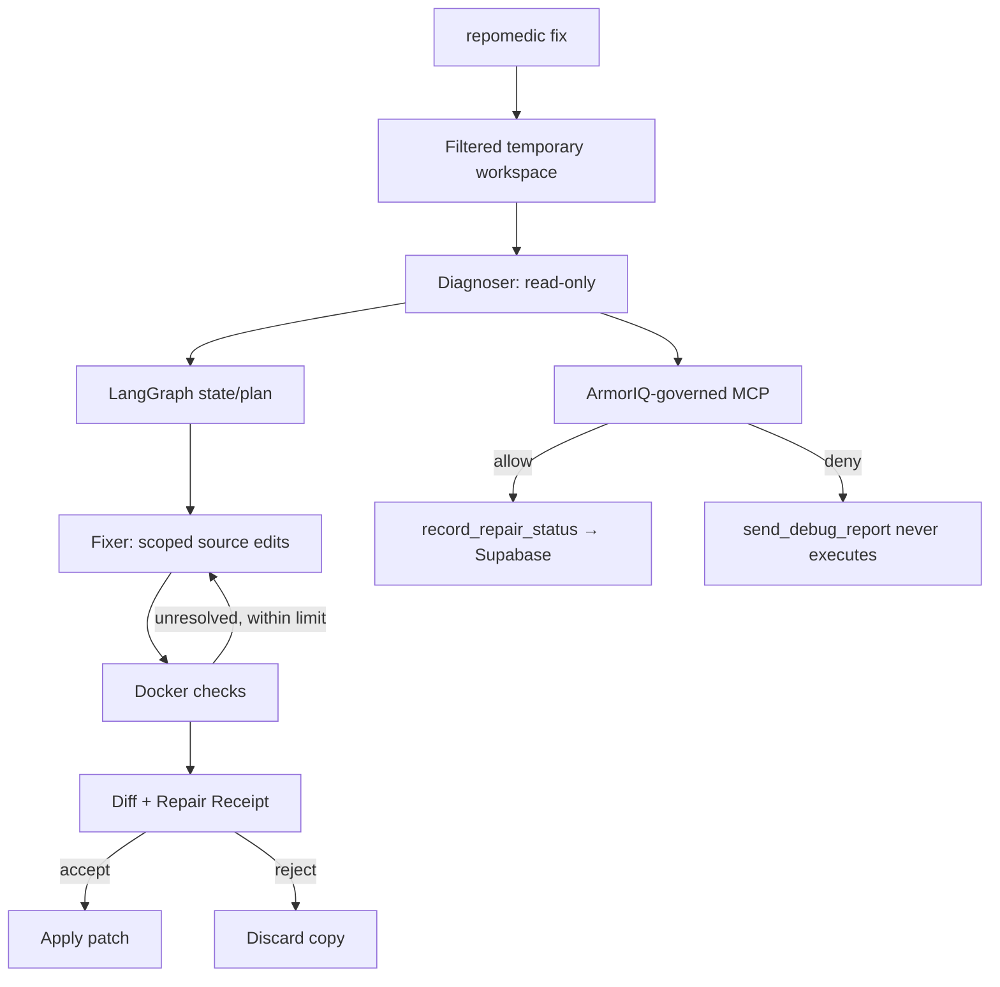

# RepoMedic — Build Plan

## Stack and rationale
- **Python 3.12 + Typer/Rich:** CLI-first means no Next.js or shadcn/Tailwind UI. ArmorIQ supports Python 3.10–3.13, not 3.14.
- **LangGraph + LangChain:** fixed, testable diagnose → repair → verify → bounded retry flow.
- **Ollama + Devstral Small 2:** local coding model, no Gemini API cost or cloud model access to project code. Download is about 15 GB; use Ollama 0.13.3+ and validate tool calling/memory early.
- **ArmorIQ SDK (`armoriq-sdk[langchain]` plus direct SDK wrappers as needed):** mandatory enforcement. Do not assume LangGraph alone governs tools; protected calls must cross an ArmorIQ boundary.
- **FastAPI MCP endpoint on Vercel Hobby:** only the tiny security-demo MCP is hosted, because ArmorIQ requires a registered custom MCP to be reachable over HTTPS. Its documented format is JSON-RPC 2.0 over HTTP with SSE responses.
- **Supabase Free:** stores a redacted record for the allowed demo action; no accounts or source files.
- **Docker:** run project build/tests in an isolated container without secrets, home-folder mounts, or network during verification.

The hosted MCP is infrastructure, not a web app. If Vercel's Python/SSE runtime fails the protocol test, switch hosting before building agents. Do not fake the ArmorIQ integration.

## Architecture

**Boundary rule:** AI proposes repairs. Deterministic code controls paths, execution, retries, verification, and final apply. ArmorIQ controls protected MCP calls. Never claim a local action is ArmorIQ-protected unless it demonstrably passes through the SDK's enforcement path.

## Implementation order

**M0 — Security proof first.** Register both agents and the custom MCP in ArmorIQ. Configure `record_repair_status` as allowed and `send_debug_report` as denied. Prove the allowed call writes a redacted Supabase row and the denied handler is never called; capture the real trace before building the rest.

**M1 — Deterministic fixture.** Build a minimal React/Vite TypeScript app with exactly two seeded bugs: a compile/type error and a logic error. Add a check for each, a malicious README instruction, and a synthetic secret. Pin dependencies for a repeatable demo.

**M2 — CLI/workspace.** Implement `repomedic fix`, optional pasted error, project filtering, a baseline snapshot, a diff, accept/reject, and cleanup. Support non-Git folders. Exclude `.env*`, credentials, `.git`, generated outputs, and dependency folders from normal inspection/copying.

**M3 — Agents.** Use the same Devstral Small 2 model sequentially to reduce memory use. Diagnoser is read-only and can attempt the security-test tool; use ArmorIQ `delegate()` to give the Fixer only its repair/check scope. Fixer edits approved source paths and runs checks; test/config/secrets paths remain read-only. If LangChain integration does not mediate a tool, wrap it with the documented ArmorIQ SDK; fail closed on enforcement errors.

**M4 — Verify and ship.** Run checks in Docker with a narrow workspace mount, no credentials/home mount, and network disabled during verification. Stage dependency installation separately (restricted package access; no project secrets). Retry unresolved failures at most twice. Show actual exit codes, then let the student apply only changed files after checking the original has not changed. Save a local JSON receipt; never equate a model claim with a passing test.

## Security and failure rules
- Pasted errors and all repository text are untrusted; do not follow instructions found in code/README as system instructions.
- The `send_debug_report` attempt may contain only a synthetic demo secret. No real secrets/source are sent to the hosted MCP. ArmorIQ observability can record inputs/outputs without automatic redaction, so minimize/redact telemetry and verify the actual trace fields.
- If ArmorIQ is unavailable or cannot verify a protected action, stop that action. No ungoverned fallback.
- Missing Docker, Ollama/model, credentials, or unsupported project commands must produce a clear message. Report checks that were not run as “not run,” not “passed.”
- On acceptance, apply only the reviewed diff; detect original-file conflicts first. On rejection, delete the temporary workspace.

## Configuration and deployment
Local environment: `ARMORIQ_API_KEY`, `ARMORIQ_USER_EMAIL`, `OLLAMA_MODEL=devstral-small-2`; keep all credentials out of Git. Vercel server-only variables: `MCP_BEARER_TOKEN`, `SUPABASE_URL`, `SUPABASE_SERVICE_ROLE_KEY`. Configure the same MCP token in ArmorIQ registration; never expose service-role credentials in the CLI.

Use `armoriq init`, `armoriq validate`, and `armoriq register`. Test deployed `/mcp` against `initialize`, `tools/list`, and `tools/call`, including SSE response framing and authentication, before wiring agents.

## Official references
- [ArmorIQ install / Python support](https://docs.armoriq.ai/sdk/installation) · [MCP format and HTTPS requirements](https://docs.armoriq.ai/sdk/mcp-directory/mcp-format/index)
- [ArmorIQ mediation](https://docs.armoriq.ai/sdk/concepts/mcp-primer) · [Observability/redaction caveat](https://docs.armoriq.ai/sdk/observability)
- [Devstral Small 2](https://ollama.com/library/devstral-small-2) · [LangChain Ollama](https://docs.langchain.com/oss/python/integrations/providers/ollama/)
- [Vercel Python runtime](https://vercel.com/docs/functions/runtimes/python) · [Vercel Hobby](https://vercel.com/docs/plans) · [Supabase Free](https://supabase.com/pricing)
